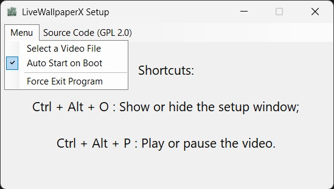

# LiveWallpaperX

A lightweight live wallpaper utility for Windows 11. Portable, no installation required, and compatible with the latest version of Windows 11.

---

[简体中文](./README.zh_CN.md) | [English](./README.md)

## Download

- [GitHub](https://github.com/lalakii/LiveWallpaperX)
- [China mirror](https://lalaki.cn/m/LiveWallpaperX)
- [SourceForge](https://sourceforge.net/projects/livewallpaperx/files/)

## Keyboard Shortcuts

| Shortcut | Function |
|---|---|
| <kbd>Ctrl</kbd> + <kbd>Alt</kbd> + <kbd>O</kbd> | Show or hide settings |
| <kbd>Ctrl</kbd> + <kbd>Alt</kbd> + <kbd>P</kbd> | Play or pause the video |

## License

Released under the [GPL-2.0](./LICENSE) license.